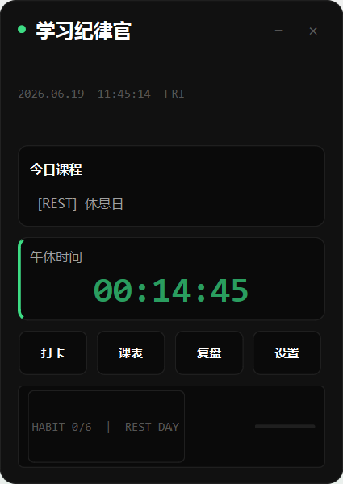
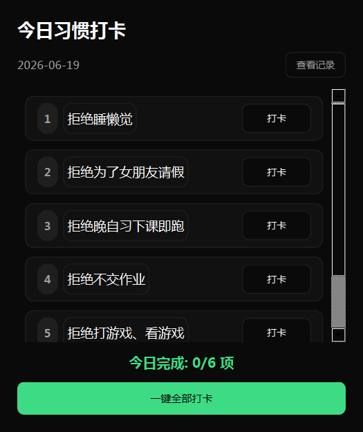
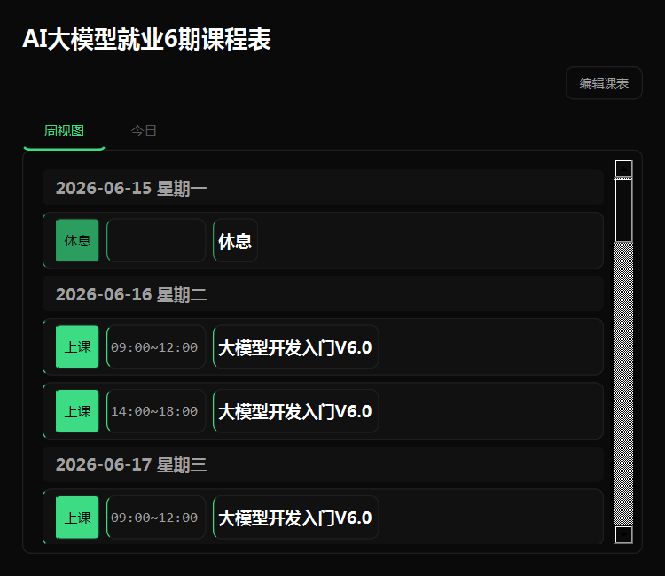
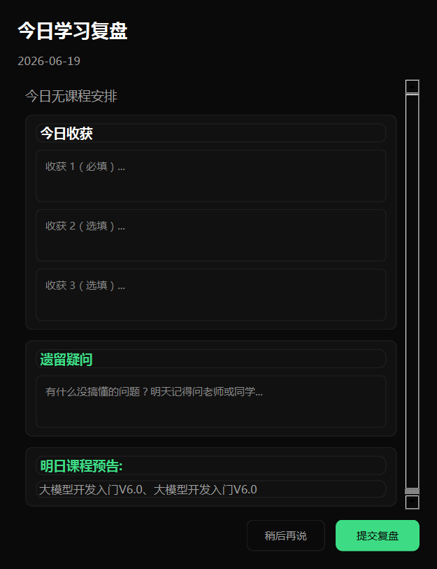
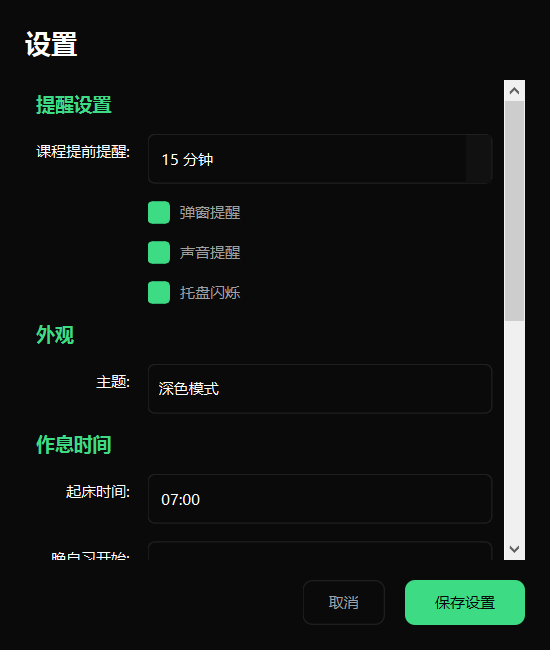
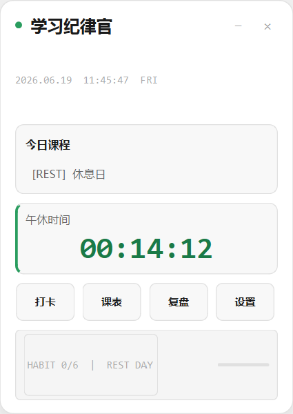
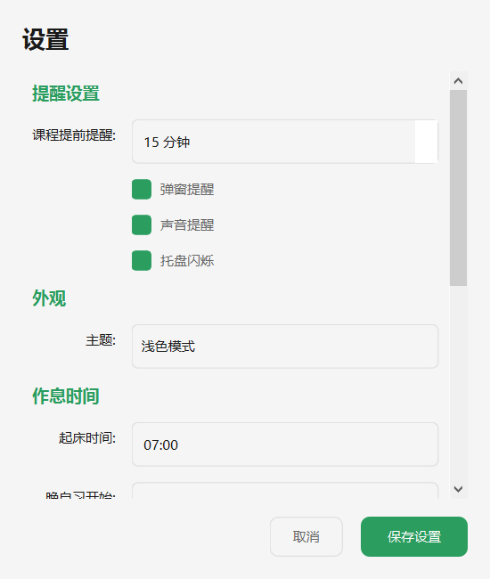

# TRAE Study Reminder

<div align="center">

**学习纪律官** —— 专治AI培训班学生的"拖延症+健忘症"

[](https://www.python.org/)
[](https://www.riverbankcomputing.com/software/pyqt/)
[](LICENSE)

[English](README_EN.md) | 简体中文

</div>

---

## 项目简介

一个悬浮在桌面右上角的极简小面板，像一位随时在线的"数字班主任"，帮AI培训班学生管理课程、监督习惯、提醒作息。

**核心特点**：
- 无需安装，单文件exe即插即用
- TRAE纯黑极简风格，高对比度设计
- 全天候智能提醒（上课、午休、晚自习、就寝）
- 6项学习纪律打卡 + 连续天数统计
- 深色/浅色主题一键切换

---

## 功能特性

| 功能 | 说明 |
|------|------|
| **今日课程** | 自动显示当天课程安排，上课前15分钟弹窗提醒 |
| **习惯打卡** | 6项学习纪律（按时上课、课堂专注、完成作业等），一键打卡+连续天数统计 |
| **每日复盘** | 记录今日收获、遗留疑问，自动生成明日课程预告 |
| **智能提醒** | 起床、晨检、上课、午休、晚自习、就寝——全天作息自动提醒 |
| **主题切换** | 深色/浅色模式一键切换，适配不同桌面壁纸 |
| **开机自启** | 写入Windows注册表，开机自动运行，无需手动打开 |

---

## 界面展示

### 深色主题（TRAE纯黑极简风）







### 浅色主题




---

## 快速开始

### 方式一：下载exe（推荐）

1. 下载最新版 `学习纪律官.exe`
2. 双击运行，首次启动会自动在同级目录创建 `data` 文件夹存储数据
3. 按 `Esc` 最小化到系统托盘，双击托盘图标恢复

### 方式二：从源码运行

```bash
# 克隆仓库
git clone https://github.com/gjw/TRAE-Study-Reminder.git
cd TRAE-Study-Reminder

# 创建虚拟环境
python -m venv venv
.\venv\Scripts\activate  # Windows
# source venv/bin/activate  # Linux/Mac

# 安装依赖
pip install -r requirements.txt

# 运行
python main.py
```

---

## 快捷键

| 快捷键 | 功能 |
|--------|------|
| `Esc` | 最小化到托盘 |
| `Ctrl + Shift + H` | 最小化到托盘 |
| `Ctrl + Shift + S` | 显示/隐藏切换 |
| `Ctrl + W` | 退出程序 |
| 双击托盘图标 | 恢复显示 |

---

## 技术栈

- **Python 3.12**：核心开发语言
- **PyQt6**：跨平台GUI框架
- **SQLite**：本地数据存储
- **PyInstaller**：打包为单文件exe

---

## 开发说明

### 项目结构

```
study-reminder/
├── core/              # 业务逻辑层
│   ├── auto_start.py  # Windows开机自启
│   ├── config.py      # 配置管理
│   ├── course_data.py # 课程数据初始化
│   ├── database.py    # 数据库操作
│   ├── reminder_engine.py # 提醒引擎
│   └── theme.py       # 主题管理
├── ui/                # 界面层
│   ├── main_panel.py  # 主面板
│   ├── habit_panel.py # 打卡面板
│   ├── course_view.py # 课程表
│   ├── review_dialog.py # 复盘对话框
│   ├── settings_dialog.py # 设置面板
│   └── reminder_popup.py # 提醒弹窗
├── data/              # 数据目录（自动生成）
│   ├── study_reminder.db # SQLite数据库
│   └── config.json    # 用户配置
├── main.py            # 程序入口
├── build.py           # 打包脚本
└── requirements.txt   # 依赖列表
```

### 打包为exe

```bash
# 安装打包工具
pip install pyinstaller

# 执行打包
python build.py

# 输出文件：dist/学习纪律官.exe
```

---

## 常见问题

**Q：主题切换后设置对话框颜色没变？**

A：重新打开设置对话框即可。

**Q：开机自启设置后没效果？**

A：确保以exe方式运行（非python main.py），注册表才会正确指向exe路径。

**Q：数据文件在哪里？**

A：在exe同级目录的 `data` 文件夹中。如需重置课程数据，可删除 `study_reminder.db` 后重新启动。

---

## 贡献指南

欢迎提交 Issue 和 Pull Request！

1. Fork 本仓库
2. 创建特性分支 (`git checkout -b feature/AmazingFeature`)
3. 提交更改 (`git commit -m 'Add some AmazingFeature'`)
4. 推送到分支 (`git push origin feature/AmazingFeature`)
5. 开启 Pull Request

---

## 许可证

本项目采用 MIT 许可证 —— 详见 [LICENSE](LICENSE) 文件

---

## 致谢

- [TRAE AI](https://www.trae.cn/) —— 本项目完全使用 TRAE IDE 辅助开发
- [PyQt6](https://www.riverbankcomputing.com/software/pyqt/) —— 强大的Python GUI框架
- [PyInstaller](https://www.pyinstaller.org/) —— 优秀的Python打包工具

---

<div align="center">

**如果这个项目对你有帮助，请给一个 ⭐ Star 支持一下！**

Made with ❤️ by [gjw](https://github.com/gjw)

</div>